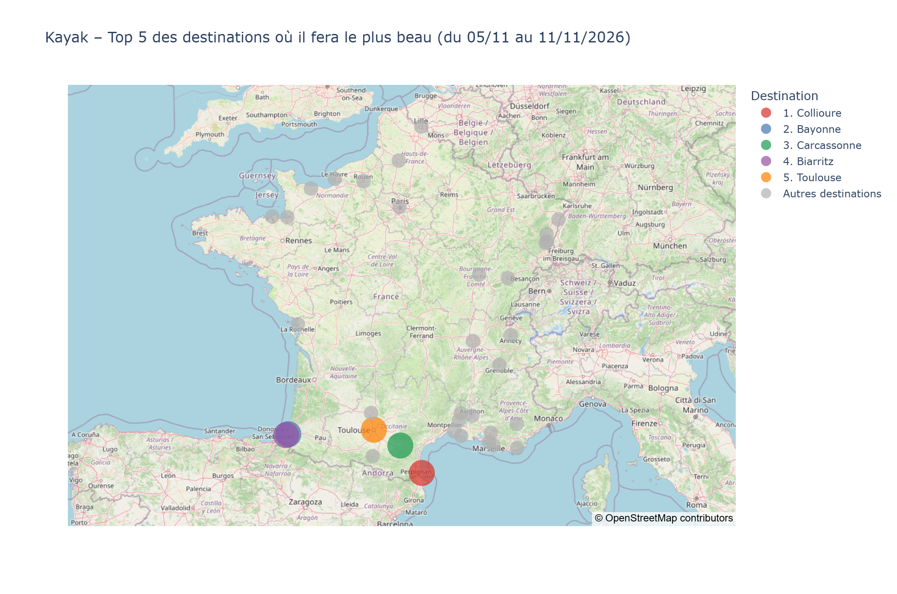
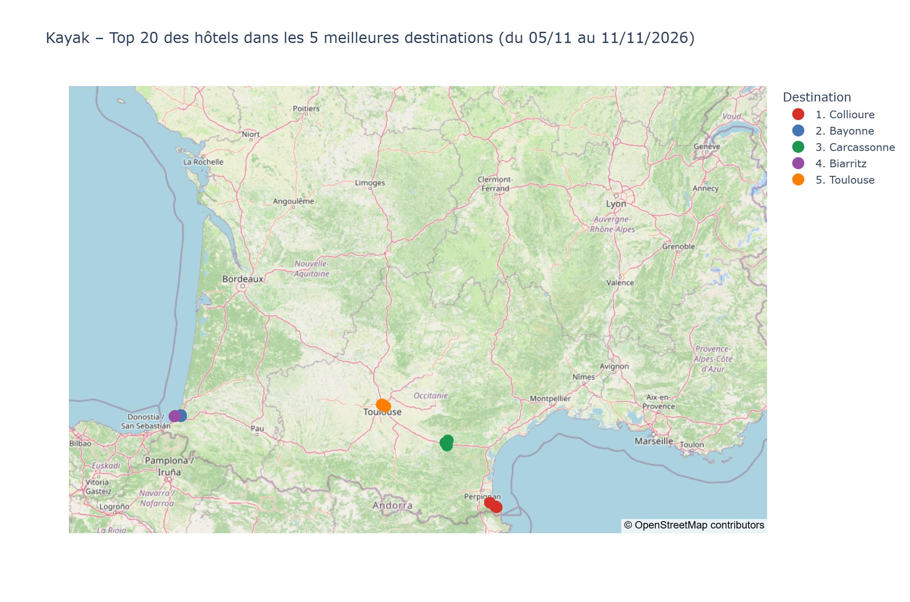
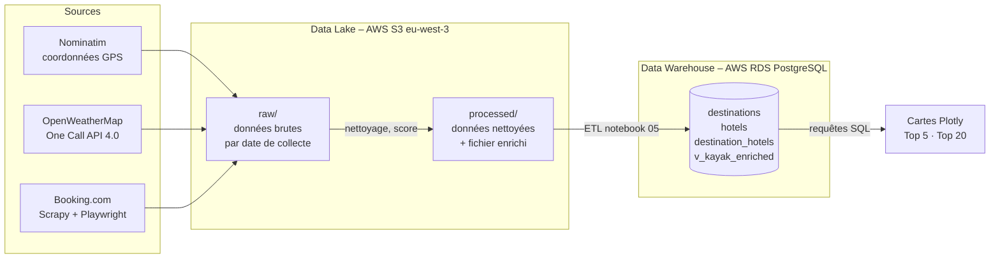
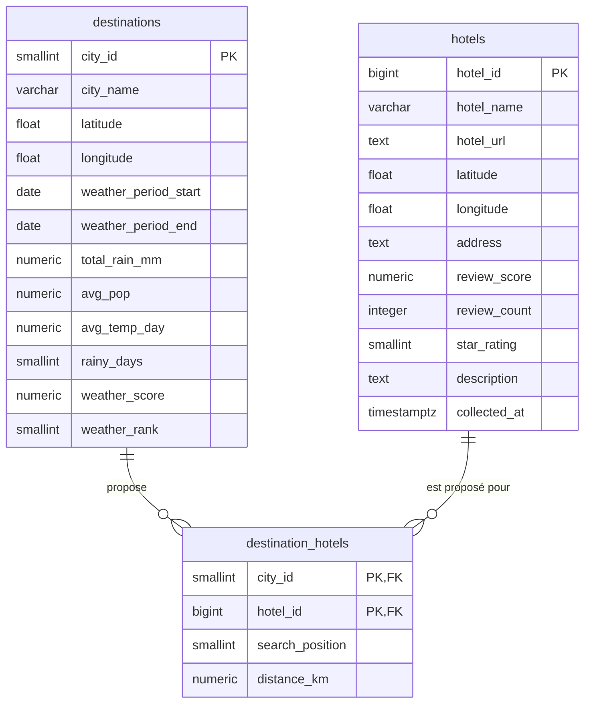

# Plan your trip with Kayak
Projet du bloc 1 – Construction et alimentation d'une infrastructure de gestion de données de la certification RNCP35288 *Concepteur développeur en science des données* (formation Jedha Fullstack Data Science).

## Contexte

L'équipe marketing de Kayak souhaite une application qui recommande **où partir** et **où dormir** en France,
à partir de données réelles de **météo** et d'**hôtels**. Le projet démarrant sans aucune donnée, l'objectif est de
construire l'infrastructure qui les collecte, les stocke et les met à disposition des équipes d'analyse :

1. collecter les coordonnées GPS, la météo à 7 jours et les hôtels de **35 destinations françaises** ;
2. stocker toutes les données dans un **Data Lake** (AWS S3) ;
3. les nettoyer et les charger dans un **Data Warehouse** (AWS RDS PostgreSQL) par un processus **ETL** ;
4. produire deux cartes : le **Top 5 des destinations** et le **Top 20 des hôtels**.

## Résultats

Prévisions collectées le 04/11/2026, pour la période **du 05/11 au 11/11/2026** :

| Rang | Destination | Score beau temps | Pluie sur 7 jours | Probabilité moyenne de pluie | Température moyenne |
|:---:|---|:---:|:---:|:---:|:---:|
| 1 | Collioure | 0,933 | 1,0 mm | 27 % | 16,8 °C |
| 2 | Bayonne | 0,914 | 5,6 mm | 26 % | 17,0 °C |
| 3 | Carcassonne | 0,894 | 3,0 mm | 23 % | 15,6 °C |
| 4 | Biarritz | 0,890 | 5,6 mm | 30 % | 16,5 °C |
| 5 | Toulouse | 0,882 | 3,7 mm | 24 % | 15,4 °C |

À l'opposé du classement : les Alpes et le Jura (Annecy, Grenoble, Besançon), avec 50 à 80 mm de pluie prévus.

| Top 5 des destinations | Top 20 des hôtels (4 par destination) |
|---|---|
|  |  |

**Cartes interactives en ligne** (zoom, survol d'un point pour le détail de la destination ou de l'hôtel) :
[Top 5 des destinations](https://fred-ant.github.io/kayak-plan-your-trip/outputs/maps/top5_destinations.html) ·
[Top 20 des hôtels](https://fred-ant.github.io/kayak-plan-your-trip/outputs/maps/top20_hotels.html)

> Le fond de carte provient des serveurs OpenStreetMap, gérés par des bénévoles, qui refusent les pages ouvertes
> directement depuis un disque (`file://`, sans page d'origine) : les cartes sont donc publiées avec **GitHub Pages**.
> Hors connexion, les images PNG ci-dessus en donnent un aperçu.

**Volumes** : 35 destinations · 350 prévisions journalières · 700 résultats Booking (693 hôtels distincts) · 6 fichiers dans le Data Lake · 3 tables et 1 vue dans le Data Warehouse.

## Architecture



## Déroulement du projet

| Étape | Notebook / script | Ce qui est fait | Sortie |
|:---:|---|---|---|
| 0 | – | Dépôt, environnement, utilisateur IAM au moindre privilège, secrets dans `.env` | Structure du projet |
| 1 | `01_geocoding.ipynb` | Géocodage des 35 destinations (Nominatim), contrôles qualité | `cities.csv` |
| 2 | `02_weather.ipynb` | Prévisions à 10 jours, indicateurs sur J+1 à J+7, **score « beau temps »** | `weather_daily.csv`, `weather_summary.csv` |
| 3 | `03_scraping_booking.ipynb` + `scraping/booking_spider.py` | Scraping des 20 meilleurs hôtels par destination | `hotels_booking.json`, `hotels.csv` |
| 4 | `04_datalake_s3.ipynb` | Fichier enrichi, envoi dans S3, contrôles de sécurité | Data Lake |
| 5 | `05_etl_s3_to_rds.ipynb` + `sql/schema.sql` | ETL S3 → RDS, schéma normalisé, vérification S3 = RDS | Data Warehouse |
| 6 | `06_maps.ipynb` | Requêtes SQL et cartes | `outputs/maps/` |

### Score « beau temps » (étape 2)

Calculé sur les 7 jours à partir du lendemain de la collecte, après normalisation min-max des indicateurs sur les 35 villes :

`score = 0,5 × (1 − pluie totale normalisée) + 0,2 × (1 − probabilité moyenne de pluie) + 0,3 × température moyenne normalisée`

La pluie pèse 70 % (quantité et risque) ; la température 30 % (en novembre, il vaut mieux qu'il fasse plus chaud).

### Collecte Booking (étape 3)

Une requête simple reçoit une page de **vérification anti-robot AWS WAF** (code HTTP 202, script `challenge.js`).
Le spider Scrapy charge donc les pages avec un **navigateur Chromium réel** (`scrapy-playwright`), sans aucun camouflage
(en-têtes du navigateur, pas de rotation d'adresses IP, arrêt en cas de CAPTCHA). Les données sont extraites du bloc JSON
intégré à chaque page de résultats (coordonnées, adresse, note, nombre d'avis, description) : **35 pages suffisent**,
au lieu d'ouvrir la page de chaque hôtel.

## Data Lake (AWS S3)

```
s3://kayak-plan-your-trip-fo/
├── raw/                                   # données brutes, jamais modifiées
│   ├── cities/collected_date=2026-11-04/cities.csv
│   ├── weather/collected_date=2026-11-04/weather_daily.csv
│   └── hotels/collected_date=2026-11-05/hotels_booking.json
└── processed/                             # dernière version nettoyée, source de l'ETL
    ├── weather_summary.csv
    ├── hotels.csv
    └── kayak_enriched.csv                 # livrable : une ligne par hôtel, avec la météo de sa destination
```

## Data Warehouse (AWS RDS PostgreSQL)



- **Table d'association** : un même hôtel peut être proposé pour deux destinations voisines (ex. : Colmar et Eguisheim) ;
  ses informations ne sont stockées qu'une fois.
- **Contraintes** : clés primaires et étrangères, règles `CHECK` (note entre 0 et 10, probabilité entre 0 et 1…).
- **Vue `v_kayak_enriched`** : restitue exactement le fichier `processed/kayak_enriched.csv` du Data Lake
  (vérifié valeur par valeur dans le notebook 05).
- **ETL rejouable** : schéma recréé et données rechargées dans une seule transaction (tout ou rien).
- **Maîtrise des coûts** : une fois le projet terminé, la base a été supprimée après création d'un *snapshot* final
  (`kayak-db-final-snapshot`, chiffré), restaurable à l'identique pour une démonstration. Le Data Lake S3 reste la
  source de référence : la base peut aussi être reconstruite en relançant le notebook 05.

## Sécurité et protection des données

| Mesure | Mise en œuvre |
|---|---|
| Secrets hors du code | Clés lues dans `.env` (exclu de Git par `.gitignore`) ; modèle sans valeur : `.env.example` |
| Moindre privilège | Utilisateur IAM `kayak-project` : accès à **un seul bucket** ([politique](docs/iam_policy_kayak.json)), sans console ; refus `AccessDenied` démontrés dans le notebook 04 |
| Comptes protégés | Compte root réservé aux opérations exceptionnelles, MFA ; administrateur nominatif avec MFA ; budget avec alerte |
| Data Lake privé | *Block all public access*, chiffrement SSE-S3, versioning |
| Data Warehouse | Accès réseau limité à une seule adresse IP (security group), connexion chiffrée (SSL), stockage chiffré (KMS) |
| Localisation | Région `eu-west-3` (Paris) : données hébergées dans l'Union européenne |
| RGPD | Aucune donnée personnelle collectée : seulement des informations d'établissements (ni avis ni données de clients) ; filtre « hôtels » qui exclut les locations entre particuliers (adresses de domiciles privés) |

**Usage de Booking.com** : la collecte est réalisée à des fins **strictement pédagogiques**, à la demande de l'énoncé,
avec une charge minimale sur le site (35 pages, une à la fois, 3 secondes d'intervalle). Les conditions d'utilisation
de Booking n'autorisent pas la collecte automatisée : en contexte professionnel, il faudrait passer par une source
autorisée (API partenaire, accord de données).

## Preuves (captures de la console AWS)

Les ressources AWS étant arrêtées ou supprimées après le projet, leur configuration est documentée par des captures
(identifiant du compte AWS et adresse IP masqués) :

| Capture | Ce qu'elle montre |
|---|---|
| [Bucket S3](docs/img/s3_bucket.png) | Organisation du Data Lake en zones `raw/` et `processed/` |
| [Zone processed](docs/img/s3_processed.png) | Les 3 fichiers nettoyés, dont le fichier enrichi `kayak_enriched.csv` |
| [Politique IAM](docs/img/iam_policy.png) | Droits de l'utilisateur `kayak-project` limités à un seul bucket |
| [Refus AccessDenied](docs/img/access_denied.png) | Démonstration du moindre privilège (notebook 04) |
| [Configuration RDS](docs/img/rds_configuration.png) | PostgreSQL 18.3, `db.t4g.micro`, Single-AZ, stockage chiffré |
| [Connectivité RDS](docs/img/rds_connectivity.png) | Pare-feu : une seule adresse IP autorisée en entrée (`/32`) |

## Reproduire le projet

**Prérequis** : Anaconda, un compte AWS, une clé API OpenWeatherMap (abonnement *One Call API*).

```powershell
git clone https://github.com/Fred-Ant/kayak-plan-your-trip.git
cd kayak-plan-your-trip
conda create -n kayak python=3.11 -y
conda activate kayak
pip install -r requirements.txt
playwright install chromium
copy .env.example .env      # puis renseigner les valeurs
```

**Ressources AWS à créer** (console, avec un compte administrateur) :
1. un utilisateur IAM avec la politique `docs/iam_policy_kayak.json` (nom du bucket à adapter) et une clé d'accès ;
2. un bucket S3 privé en `eu-west-3` ;
3. une base RDS PostgreSQL (`db.t4g.micro`, Single-AZ, base initiale `kayak`), accessible depuis sa seule adresse IP.

**Ordre d'exécution** : notebooks `01` à `03` (avec, pour l'étape 3, la commande indiquée dans le notebook :
`scrapy runspider scraping/booking_spider.py -O data/raw/hotels_booking.json`), puis `04`, `05` et `06`.

## Limites et améliorations possibles

- **Score météo** : la normalisation min-max est sensible aux valeurs extrêmes (un épisode méditerranéen à 90 mm écrase
  l'échelle de la pluie) ; pondération pensée pour l'automne. Pistes : normalisation par le rang, poids saisonniers.
- **Données datées** : météo et hôtels dépendent de la date de collecte ; il faudrait **planifier** la collecte
  (ex. : Apache Airflow) et conserver l'historique (déjà prévu par le partitionnement `collected_date=` du Data Lake).
- **Booking** : 15 à 20 résultats par page ; dépendance à la structure de la page, susceptible de changer.
- **Destinations hors villes** : Ariège (département), Gorges du Verdon, Château du Haut-Kœnigsbourg : un point
  représentatif est utilisé pour la météo, les hôtels sont recherchés dans les environs.
- **Production** : mot de passe de la base dans AWS Secrets Manager, authentification IAM à la base, Multi-AZ,
  vérification complète du certificat SSL (`verify-full`), journaux exportés vers CloudWatch.
- **Volumétrie** : pour des données massives, Spark ou un entrepôt distribué (Amazon Redshift) remplaceraient pandas et PostgreSQL.

## Compétences du référentiel (bloc 1)

| Compétence | Où elle est mise en œuvre |
|---|---|
| **C1** – Concevoir une architecture Data Lake / Data Warehouse sécurisée | S3 (zones `raw`/`processed`, partitionnement par date), RDS (modèle normalisé, contraintes), sécurité IAM, réseau, chiffrement |
| **C2** – Stockage et calcul distribués (Spark, Redshift) | Non mis en œuvre (volume de données faible) ; discuté dans les limites et améliorations |
| **C3** – Collecter des données de sources variées, dans le respect du RGPD | API Nominatim et OpenWeatherMap, scraping Booking avec Scrapy, aucune donnée personnelle |
| **C4** – Nettoyer et organiser les données par un ETL | Notebook 05 : extraction depuis S3, transformation en 3 tables, chargement transactionnel, vérification S3 = RDS |

## Structure du dépôt

```
kayak-plan-your-trip/
├── notebooks/              # étapes 1 à 6, dans l'ordre d'exécution
├── scraping/               # spider Scrapy (Booking.com)
├── sql/schema.sql          # schéma du Data Warehouse
├── docs/                   # politique IAM, captures de la console AWS
├── outputs/maps/           # cartes (HTML interactif et PNG)
├── data/                   # données locales de travail (exclues de Git)
├── .env.example            # modèle de configuration (sans secret)
└── requirements.txt        # dépendances, versions figées
```

## Sources de données

- [Nominatim](https://nominatim.org/) – données © contributeurs [OpenStreetMap](https://www.openstreetmap.org/copyright) (licence ODbL)
- [OpenWeatherMap One Call API 4.0](https://openweathermap.org/api/one-call-4) – prévisions météo
- [Booking.com](https://www.booking.com/) – informations sur les hôtels (usage pédagogique)
- Fonds de carte : © contributeurs OpenStreetMap
